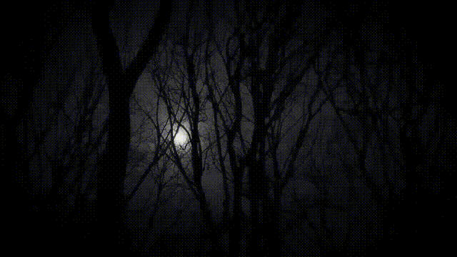

  

<h1 align="center" color="red">Askanty </h1>

###

# 👾 Hey, I'm a Developer!

  

  💜 Student Developer · 💻 Python · 🚀 Aspiring Fullstack Developer

---

## 🧑‍💻 About Me

Hi! I'm a student developer passionate about programming, web development, and automation.

I enjoy exploring how technologies work, turning ideas into real projects, and continuously improving my skills.

- 🎓 IT student focused on software development
- 🐍 Working with Python
- 🌐 Interested in Fullstack Development
- 🤖 Building my own voice assistant — JARVIS
- 🎮 Developing a multiplayer browser game — Mafia Game
- ⚡ Always learning and experimenting with new technologies

## ⚙️ Tech Stack

###

  
  
  
  
  
  
  
  
  
  
  
  
  

###

  
  
  
  
  
  
  
  
  
  

###

  
  
  
  
  
  
  
  

## 🚀 Featured Projects

### 🤖 JARVIS Assistant
A personal voice assistant built with Python, featuring speech recognition, text-to-speech, and voice-controlled commands.

### 🎮 Mafia Game
A multiplayer browser game featuring private rooms, different player roles, and real-time communication.

## 🎯 Goals

- 🚀 Become a professional Fullstack Developer
- 🌐 Build complete and useful web applications
- 🧠 Improve my Python and JavaScript skills
- 💼 Gain experience working on real-world projects
- 📚 Keep learning, building, and improving

---

  <i>"Building. Learning. Improving."</i>

  

